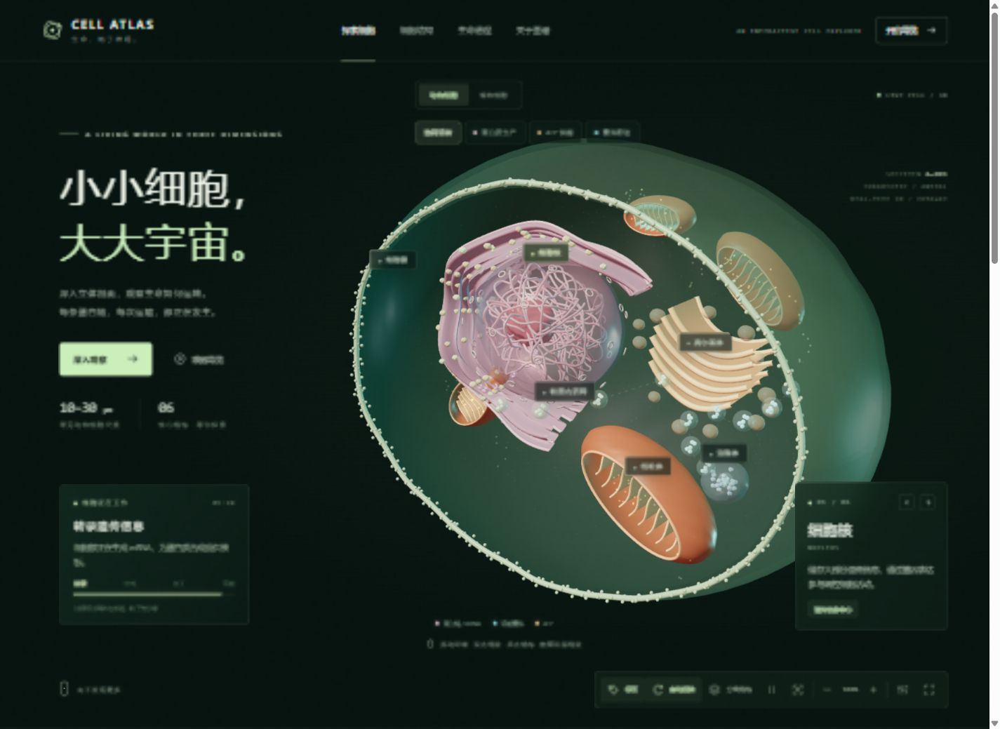

# CELL ATLAS · 3D 细胞生命实验室

一个可离线打开的细胞科普互动网页，包含实时 3D 细胞模型、粒子动画和细胞器工作过程示意。

## 打开方法

下载并解压项目后，用 Microsoft Edge 或 Google Chrome 打开根目录的 `index.html`。无需安装依赖、运行服务器或登录 ChatGPT。核心体验不需要联网；页面中的外部参考资料链接需要联网。

微信、QQ 内的文件预览可能无法运行交互，请将文件保存到电脑后用浏览器打开。手机打开本地 HTML 的支持程度因系统而异，建议优先使用电脑。

## 交互功能

- 动物细胞和植物细胞切换。
- 拖动旋转、缩放、点击细胞器查看说明。
- 蛋白质生产、ATP 供能、囊泡配送与协同运转模式。
- 结构分离、导览、标签、暂停、全屏和重置视角。
- 粒子密度和动画速度调节。
- 物质运输、能量转换与遗传信息的科普演示。

## 文件

- `index.html`：包含 HTML、CSS、交互代码与内置 Three.js 的网页。
- `THREE-LICENSE.txt`：Three.js 的 MIT 授权说明，请保留。
- `preview.jpg`：网页预览。

## 模型说明

这是用于科普的实时 3D 剖面示意模型。形态、比例、颜色与运动速度不代表真实显微观测或定量模拟，工作流程经过简化和加速。

需要支持 WebGL 的浏览器。若 3D 视图提示不可用，请检查浏览器的硬件加速设置。

参考资料：[OpenStax Biology 2e — Eukaryotic Cells](https://openstax.org/books/biology-2e/pages/4-3-eukaryotic-cells)。
